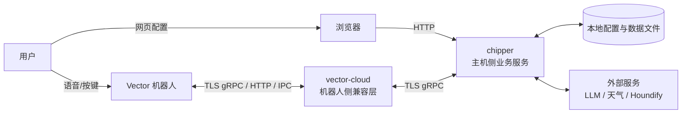
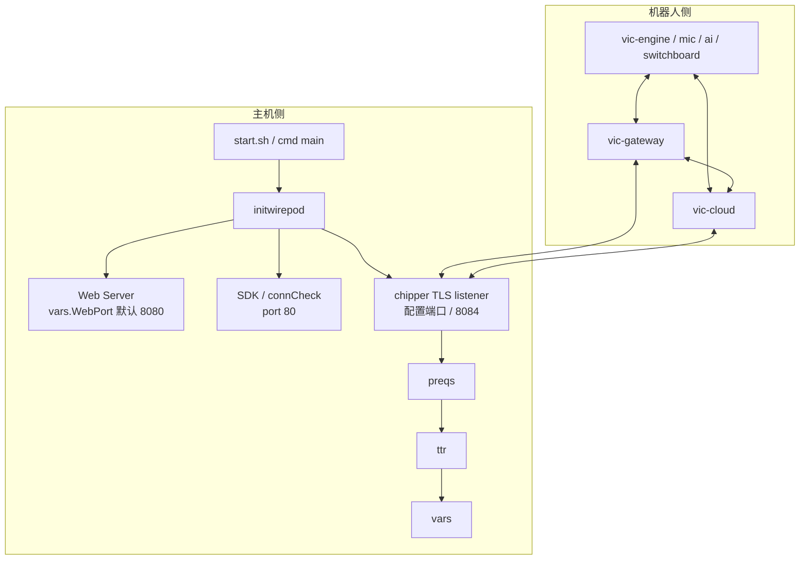
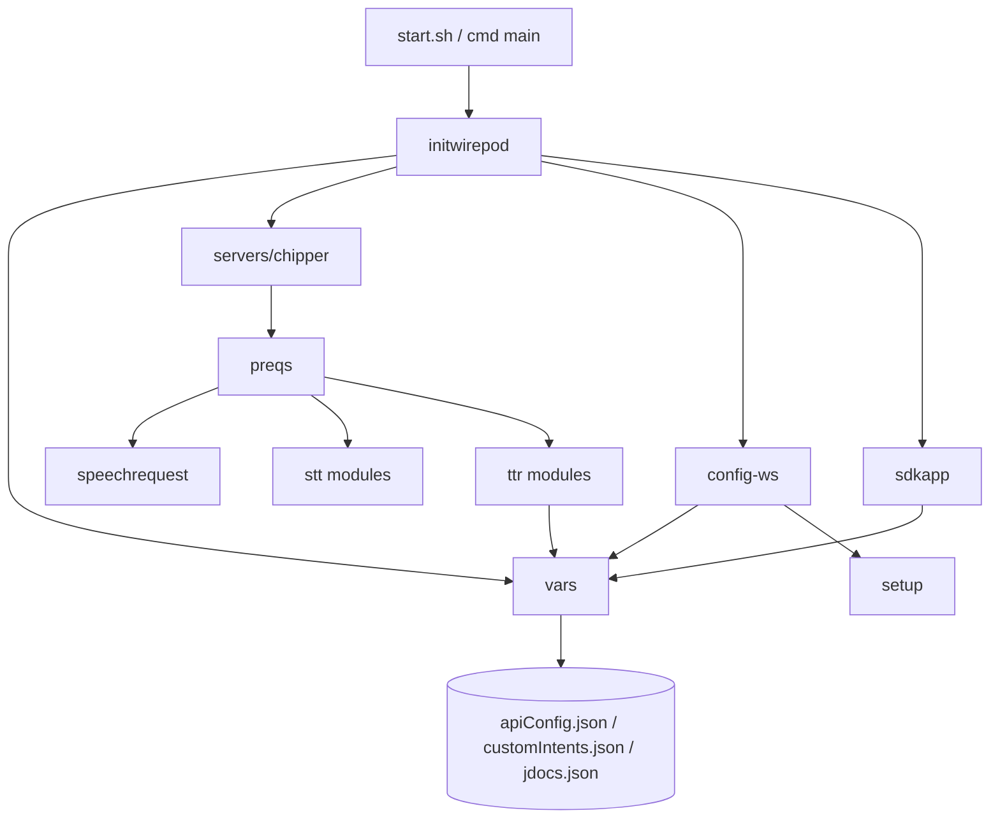
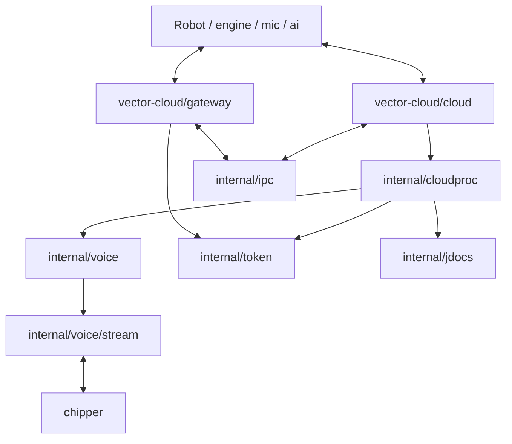

# 架构设计

这一份文档重点回答 4 个问题：

1. `wire-pod` 运行时到底由哪些进程组成
2. `chipper` 和 `vector-cloud` 的职责边界是什么
3. 机器人、网页、配置文件、外部服务分别怎么接入
4. 二开时应该把改动落在哪一层

## 1. 系统上下文

## 2. 顶层拆分

### 2.1 `chipper/`

`chipper` 是主机侧核心服务，负责真正的业务处理。代码里它承担了 5 类职责：

1. 启动和编排本地服务
2. 对外暴露 `ChipperGrpc`、`Jdocs`、`Token` 服务
3. 接收音频流并完成 STT、意图匹配、KG/LLM 处理
4. 提供配置页和 SDK 控制页
5. 管理本地配置、jdocs、自定义意图、证书和插件

### 2.2 `vector-cloud/`

`vector-cloud` 是机器人侧兼容层，目标是让机器人继续按“官方云”的方式工作，但把后端改成本地 `wire-pod`。

它不是单一进程，而是至少包含两类核心程序：

- `vector-cloud/cloud/main.go`
  - 负责 mic/ai socket、token、jdocs、voice process、offboard vision 等后台能力
- `vector-cloud/gateway/main.go`
  - 负责机器人侧外部接口网关、TLS gRPC 服务、JSON gateway、BLE 代理、IPC 管理

## 3. 运行时进程视图

### 一个很关键的实现细节

`chipper` 的网页能力不是单独前后端项目，而是 Go 进程直接启动多个 HTTP listener：

- `config-ws.StartWebServer()` 监听 `vars.WebPort`，默认 `8080`
- `sdkapp.BeginServer()` 在 goroutine 中监听 `:80`

两者都往默认 `http` mux 上注册路由，所以本质上是“同一套进程内路由 + 两个监听端口”的结构。

## 4. `chipper/` 内部架构

### 4.1 启动与编排层

关键位置：

- `chipper/start.sh`
- `chipper/cmd/*/main.go`
- `chipper/pkg/initwirepod/startserver.go`

核心职责：

- 选择 STT 入口
- 调用 `StartFromProgramInit(...)`
- 初始化 `vars`
- 创建 `preqs.Server`
- 启动 `sdkapp`、配置页、TLS gRPC 服务

### 4.2 gRPC 接入层

关键位置：

- `chipper/pkg/initwirepod/startserver.go`
- `chipper/pkg/servers/chipper/`
- `chipper/pkg/servers/jdocs/`
- `chipper/pkg/servers/token/`

实际注册的服务包括：

- `ChipperGrpc`
- `Jdocs`
- `Token`

其中 `ChipperGrpc` 又提供 3 条核心流式入口：

- `StreamingIntent`
- `StreamingIntentGraph`
- `StreamingKnowledgeGraph`

### 4.3 请求处理层 `preqs/`

关键位置：

- `chipper/pkg/wirepod/preqs/server.go`
- `chipper/pkg/wirepod/preqs/intent.go`
- `chipper/pkg/wirepod/preqs/intent_graph.go`
- `chipper/pkg/wirepod/preqs/knowledgegraph.go`

职责：

- 把 gRPC 请求转成统一的 `SpeechRequest`
- 调用具体 STT/语义处理器
- 决定走普通意图、IntentGraph、KnowledgeGraph 哪条链路

### 4.4 业务处理层 `ttr/`

这是二开最核心的一层。

职责包括：

- 插件匹配
- 自定义意图匹配
- 内置 intent 匹配
- 参数提取
- 天气等特殊业务
- KG / LLM 回答
- 最终封装 intent 或知识回答并回发给机器人

## 5. `vector-cloud/` 内部架构

### 5.1 `gateway`

主要职责：

- 提供机器人侧 `ExternalInterface` gRPC/TLS 服务
- 提供 JSON gateway
- 管理与 engine/switchboard/cloud 的 IPC
- 处理鉴权、限流、BLE 代理、token 更新监听

### 5.2 `cloud`

主要职责：

- 连接 `mic_sock`、`ai_sock`
- 构造 `voice.Process`
- 启动 `cloudproc.Run(...)`
- 把 voice、token、jdocs、offboard vision 等能力编排起来

### 5.3 `internal/voice`

这一层是“机器人语音消息 -> Chipper 流式调用”的桥梁：

- 监听 hotword、audio、audio done 等消息
- 根据模式创建 `Intent / IntentGraph / KG` 流
- 把 Chipper 的响应再转回机器人可消费的云消息
- 在这次“小智，小智”改造里，它只负责承接 `locale` 并尝试映射 `LanguageCode`，不是热词文本本身的定义位置

## 6. 配置与数据架构

| 文件/目录 | 作用 |
| --- | --- |
| `chipper/apiConfig.json` | 主配置，包含天气、知识服务、STT、服务端口等 |
| `chipper/customIntents.json` | 自定义意图配置 |
| `chipper/jdocs/jdocs.json` | 机器人 jdocs 缓存 |
| `chipper/jdocs/botSdkInfo.json` | 已接入机器人的 SDK 信息 |
| `chipper/session-certs/` | 机器人 session cert |
| `certs/server_config.json` | 下发给机器人使用的服务端配置 |
| `chipper/intent-data/*.json` | 多语言意图词库 |

这些数据主要由 `chipper/pkg/vars/` 统一管理：

- `vars.Init()` 负责初始化路径并加载配置
- `ReadConfig()` / `WriteConfigToDisk()` 管理 `apiConfig.json`
- `LoadCustomIntents()` 管理 `customIntents.json`
- `AddJdoc()` / `GetJdoc()` / `WriteJdocs()` 管理 jdocs

和这次默认唤醒词迁移直接相关的文件职责可以再单独记一下：

- `chipper/apiConfig.json`：保存 STT 语言，例如 `zh-CN`
- `chipper/jdocs/jdocs.json`：缓存机器人 `vic.RobotSettings`，包含 `locale`、`button_wakeword`
- `chipper/jdocs/botSdkInfo.json`：只保存机器人连接信息，不保存唤醒词设置

## 7. 页面与接口架构

### 7.1 配置页

- 静态资源：`chipper/webroot/`
- 后端：`chipper/pkg/wirepod/config-ws/webserver.go`
- 核心路由前缀：`/api/`
- 默认端口：`8080`

负责：

- 管理天气配置
- 管理 KG/LLM 配置
- 切换 STT 语言
- 管理自定义意图
- 查看日志和版本
- 证书生成与初始化相关能力

### 7.2 SDK 控制页

- 静态资源：`chipper/webroot/sdkapp/`
- 后端：`chipper/pkg/wirepod/sdkapp/`
- 核心路由前缀：`/api-sdk/`
- 附加能力：`/cam-stream`、`/ok`

这一层也是本次“小智，小智”需求的主要实现落点，负责：

- 调整默认页面文案
- 切换机器人 `locale`
- 回显 `button_wakeword`
- 缓存并读取 `vic.RobotSettings`
- 保留旧接口作为兼容入口，但不再把它们当成默认推荐入口

负责：

- 机器人设置修改
- 行为控制
- 摄像头与图片拉取
- 电量、脸部、事件流查询
- 通过 SDK 直接控制机器人

## 8. 设计上的关键特征

### 8.1 STT 是可插拔入口

不同 STT 对应不同入口程序：

- `cmd/vosk/main.go`
- `cmd/coqui/main.go`
- `cmd/leopard/main.go`
- `cmd/experimental/whisper/main.go`
- `cmd/experimental/whisper.cpp/main.go`

这意味着新增 STT 时，通常需要同时改：

- `pkg/wirepod/stt/`
- `cmd/`
- `start.sh`

### 8.2 业务大脑集中在 `ttr/`

真正决定“识别后如何响应”的代码，集中在：

- `matchIntentSend.go`
- `intentparam.go`
- `kgsim.go`
- `weather.go`

### 8.3 IntentGraph 是重要分水岭

老式 `Intent` 流只返回普通 intent。

`IntentGraph` 则可以：

- 返回普通 intent
- 在未命中时直接回知识回答
- 作为新版本机器人语音链路的主要入口

### 8.4 `vector-cloud` 不是可有可无

它不只是“附属工具”，而是整个机器人接入链路的协议适配层。没有它，机器人侧很多原生流程无法正常接到本地 `chipper`。

## 9. 二开时的落点建议

### 优先改 `chipper/`

适合处理：

- 新增配置项
- 改语音匹配逻辑
- 接入 LLM
- 增加自定义意图
- 增加页面按钮和接口

### 谨慎改 `vector-cloud/`

适合处理：

- 机器人和本地服务之间的协议兼容
- 音频/IPC/网关/鉴权链路
- 更底层的请求路由和响应封装

下一份建议继续看 [`core-flows.md`](./core-flows.md)，那里会把“程序真的怎么跑”拆成时序图。
