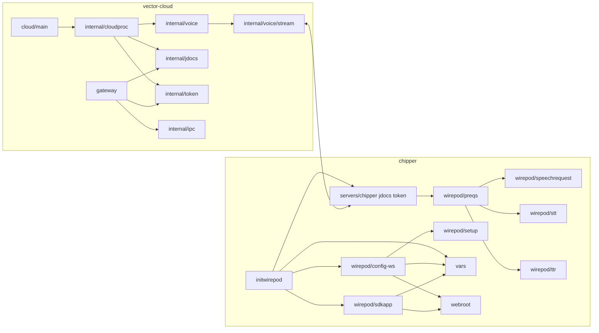
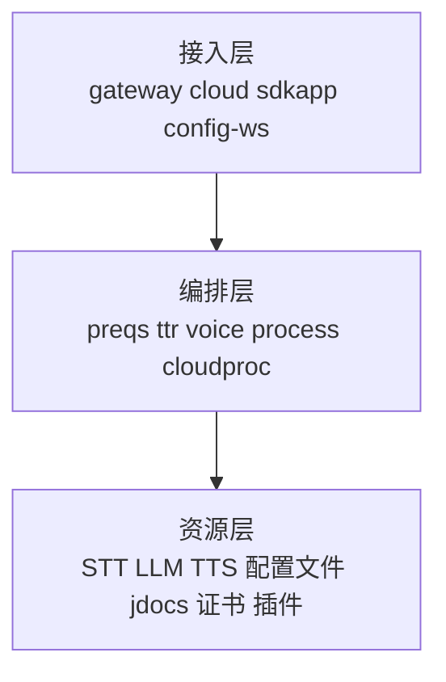

# wire-pod 代码结构

## 1. 仓库总览

当前仓库可以先按“两个主模块 + 若干支撑目录”来理解。

```text
wire-pod/
├── chipper/                  # 主机侧主服务
├── vector-cloud/             # 机器人侧兼容层与网关
├── scripts/                  # 部署与辅助脚本
├── certs/                    # 证书目录
├── vosk/                     # STT 模型/资源目录
├── compose.yaml              # 容器化运行入口
├── dockerfile                # 镜像构建
└── docs/                     # 当前整理出的项目文档
```

## 2. `chipper/` 结构

### 2.1 启动入口

- `chipper/start.sh`
  - 运行时入口脚本
  - 根据 `STT_SERVICE` 选择不同 `cmd/*/main.go`
- `chipper/cmd/vosk/main.go`
- `chipper/cmd/coqui/main.go`
- `chipper/cmd/experimental/*`

### 2.2 初始化层

- `chipper/pkg/initwirepod/startserver.go`
  - 初始化变量、STT、SDK App、chipper gRPC 服务、HTTP API
- `chipper/pkg/initwirepod/web.go`
  - 提供 `/api-chipper/*` 管理接口，比如切换端口、重启服务

### 2.3 gRPC 服务层

- `chipper/pkg/servers/chipper/*`
  - `StreamingIntent`
  - `StreamingIntentGraph`
  - `StreamingKnowledgeGraph`
- `chipper/pkg/servers/jdocs/*`
  - jdocs 服务
- `chipper/pkg/servers/token/*`
  - token 服务

### 2.4 语音处理主链

- `chipper/pkg/wirepod/speechrequest/`
  - 统一音频请求对象
  - 负责流式 chunk、PCM/Opus、VAD、结束检测
- `chipper/pkg/wirepod/stt/`
  - 各类 STT 引擎实现
- `chipper/pkg/wirepod/preqs/`
  - 请求进入后的第一层处理
  - 把 STT/意图结果转给后续逻辑
- `chipper/pkg/wirepod/ttr/`
  - Text-to-response
  - 意图匹配、参数解析、动作下发、知识问答、LLM 命令编排

### 2.5 Web 与控制层

- `chipper/pkg/wirepod/config-ws/`
  - 配置页面与 `/api/*`
- `chipper/pkg/wirepod/sdkapp/`
  - SDK App 与 `/api-sdk/*`
- `chipper/pkg/wirepod/setup/`
  - BLE / SSH / 证书 / 首次接入相关能力
- `chipper/pkg/scripting/`
  - Lua 脚本执行与 API

### 2.6 配置与全局状态

- `chipper/pkg/vars/`
  - 全局变量
  - 路径推导
  - 配置模型
  - jdocs、bot info、自定义意图、模型目录等

### 2.7 静态资源

- `chipper/webroot/`
  - 配置页 HTML/CSS/JS
  - SDK App 页面和脚本

## 3. `vector-cloud/` 结构

### 3.1 两个主程序

- `vector-cloud/cloud/main.go`
  - `vic-cloud` 入口
  - 负责语音 cloud process、token、jdocs、vision 等
- `vector-cloud/gateway/main.go`
  - `vic-gateway` 入口
  - 负责机器人外部接口服务和 IPC 桥接

### 3.2 核心包

- `vector-cloud/internal/voice/`
  - 热词/音频消息处理
  - 语音流状态机
  - 与 chipper 的流式连接
- `vector-cloud/internal/voice/stream/`
  - 流式连接封装
  - Intent / IntentGraph / KnowledgeGraph / ConnectionCheck
- `vector-cloud/internal/cloudproc/`
  - 汇总 voice、token、jdocs、vision 等能力并统一运行
- `vector-cloud/internal/jdocs/`
  - jdocs 客户端和服务端能力
- `vector-cloud/internal/token/`
  - token 获取、刷新和服务
- `vector-cloud/internal/offboard_vision/`
  - 视觉离板处理
- `vector-cloud/internal/ipc/`
  - Unix socket / datagram / stream 等 IPC 抽象

### 3.3 gateway 层

- `vector-cloud/gateway/message_handler.go`
  - 外部接口方法的主处理逻辑
- `vector-cloud/gateway/ipc_manager.go`
  - 管理与 engine、switchboard、vic-cloud 的 IPC
- `vector-cloud/gateway/tokens.go`
  - gateway 侧 token/jdocs 相关桥接

## 4. 模块关系图



## 5. 推荐阅读路径

如果你是第一次进这个项目，建议按下面顺序读。

### 路径 A：想看“机器人说话为什么能走通”

1. `vector-cloud/internal/voice/process.go`
2. `vector-cloud/internal/voice/stream/*`
3. `chipper/pkg/servers/chipper/*`
4. `chipper/pkg/wirepod/preqs/*`
5. `chipper/pkg/wirepod/ttr/*`

### 路径 B：想看“Web 配置页怎么改设置”

1. `chipper/pkg/wirepod/config-ws/webserver.go`
2. `chipper/webroot/*`
3. `chipper/pkg/vars/*`

### 路径 C：想看“SDK 控制页怎么控制机器人”

1. `chipper/pkg/wirepod/sdkapp/server.go`
2. `chipper/pkg/wirepod/sdkapp/robot.go`
3. `chipper/pkg/wirepod/sdkapp/urlreqs.go`
4. `chipper/webroot/sdkapp/js/*`

### 路径 D：想看“启动时到底跑了什么”

1. `chipper/start.sh`
2. `chipper/cmd/*/main.go`
3. `chipper/pkg/initwirepod/startserver.go`

## 6. 配置、数据和状态文件

主线代码之外，这些文件也很关键：

- `chipper/apiConfig.json`
  - 主配置
- `chipper/jdocs/*.json`
  - 机器人状态与文档缓存
- `chipper/customIntents.json`
  - 自定义意图
- `certs/*`
  - TLS 和 server config
- `chipper/intent-data/*.json`
  - 各语言内置意图库
- `chipper/plugins/*`
  - 插件目录

## 7. 需要特别注意的“非主线代码”

仓库里有一些内容很容易让人误以为是主线入口，其实更像备份、实验或工作副本：

- `chipper/pkg/wirepod/ttr/bakgo/*`
- 根目录 `kgsim.go`
- `cmd/experimental/*`
- `*.bak`

建议规则：

- 以 `start.sh` 能走到的 `cmd/*/main.go` 为主线
- 以 `pkg/initwirepod` 和 `pkg/wirepod/*` 为主业务代码
- 以 `bak`、`experimental`、根目录散落单文件为参考材料

## 8. 一个比较实用的认知模型

可以把整个项目简化成下面这三层：



这样看代码时会轻松很多：

- 想知道“请求从哪来”，看接入层
- 想知道“逻辑怎么决定”，看编排层
- 想知道“依赖什么外部资源”，看资源层
