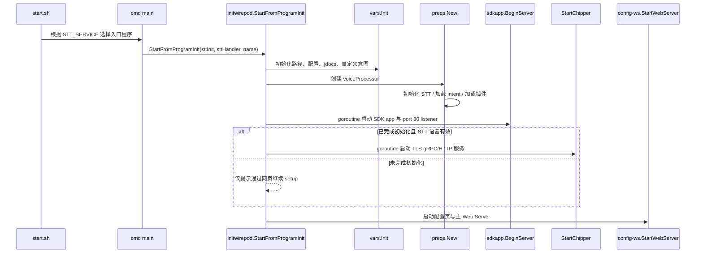
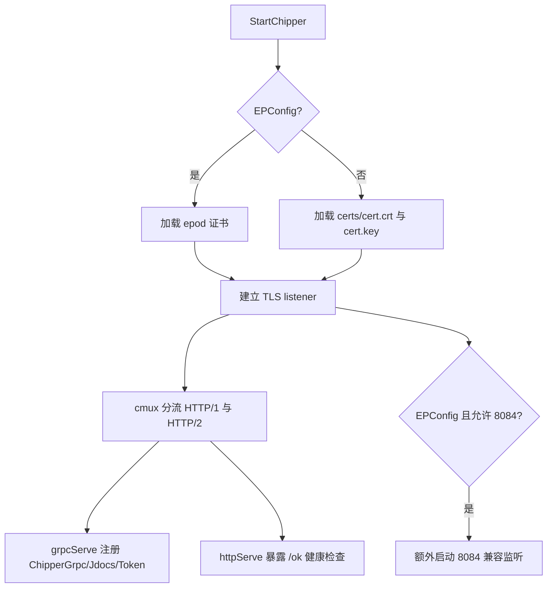
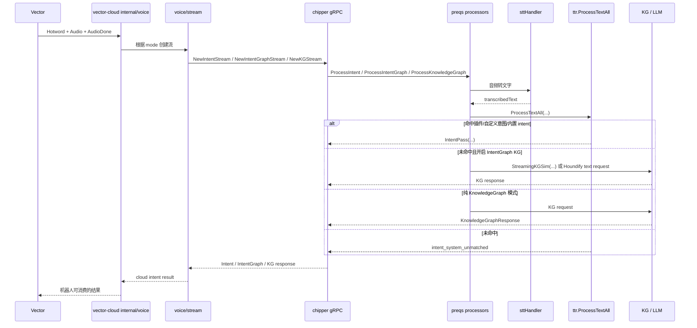
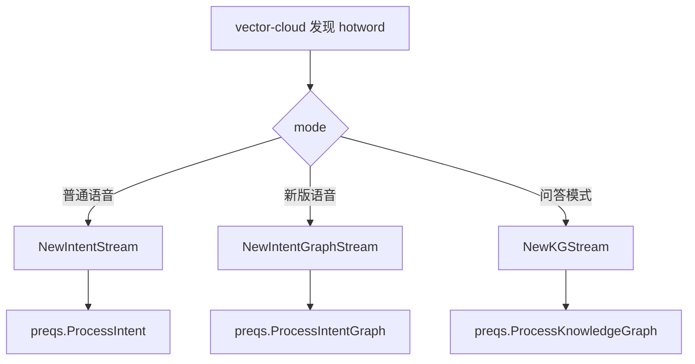
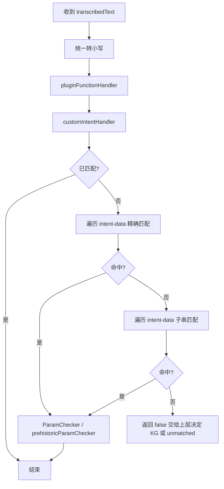
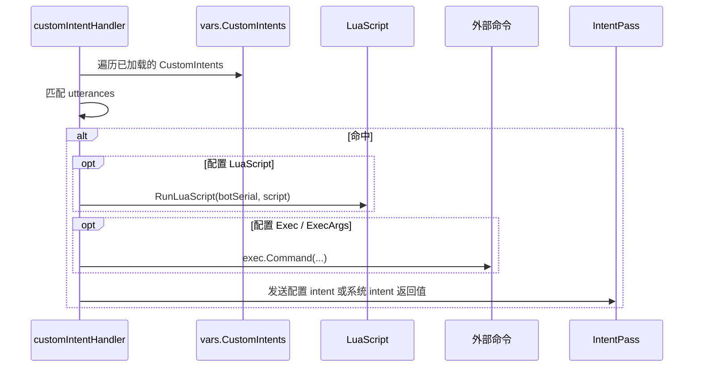
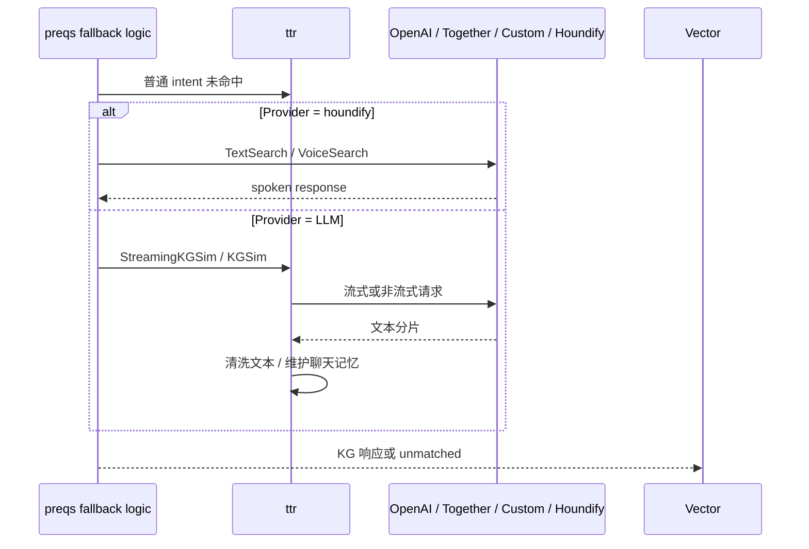
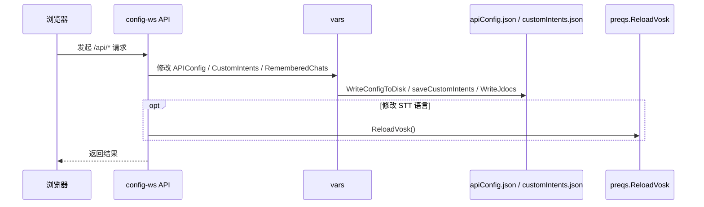
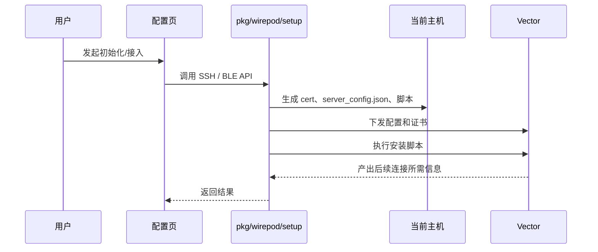

# 核心流程

这一份不按目录讲，而是按“系统运行时真的发生了什么”来讲。

## 1. `chipper` 启动流程



### 关键代码

- 启动编排：`chipper/pkg/initwirepod/startserver.go`
- 变量初始化：`chipper/pkg/vars/vars.go`
- 语音处理器创建：`chipper/pkg/wirepod/preqs/server.go`

### 需要特别记住的点

- `StartFromProgramInit()` 是 `chipper` 的主调度中心。
- `sdkapp.BeginServer()` 先作为 goroutine 启动，随后主线程进入 `config-ws.StartWebServer()`。
- 即使主语音服务还没完全 ready，配置页也会先起来，方便继续初始化。

## 2. `chipper` TLS 服务启动流程



### 关键代码

- 监听与 cmux：`chipper/pkg/initwirepod/startserver.go`
- gRPC 注册：`grpcServe(...)`

### 这里的设计目的

- 同一个 TLS 端口上同时服务 gRPC 和简单 HTTP 健康检查。
- 在 Escape Pod 模式下，额外开 `8084` 兼容旧版机器人连接行为。

## 3. 机器人语音主链路

这是整套系统里最重要的一条链路。



### 对应代码位置

| 阶段 | 关键代码 |
| --- | --- |
| 机器人语音事件接入 | `vector-cloud/internal/voice/process.go` |
| 连接 `chipper` | `vector-cloud/internal/voice/stream/connect.go` |
| gRPC 入口 | `chipper/pkg/servers/chipper/*.go` |
| 统一请求处理 | `chipper/pkg/wirepod/preqs/*.go` |
| 文本业务处理 | `chipper/pkg/wirepod/ttr/*.go` |

### 针对“小智，小智”改造要特别记住的点

1. 页面默认体验、`zh-CN` setup 入口、SDK locale 设置和 `vic.RobotSettings` 缓存都主要落在 `chipper/`
2. `vector-cloud/internal/voice/process.go` 负责把 hotword 事件里的 `locale` 映射成 `LanguageCode`
3. 当前依赖里的 `LanguageCode` 只有英文、法文、德文，因此 `zh-CN` 目前只能显式回退到英文链路
4. 所以“页面默认改成 小智，小智”与“真实语音热词一定已替换成功”必须分开验证

## 4. `Intent`、`IntentGraph`、`KnowledgeGraph` 三条分支



### 三者区别

- `ProcessIntent`
  - 传统意图流，未命中时可降级到 LLM，但输出仍偏 intent 语义
- `ProcessIntentGraph`
  - 新版混合流，既能回 intent，也能直接回知识回答
- `ProcessKnowledgeGraph`
  - 明确的知识问答流，直接面向 KG / LLM / Houndify

## 5. `ttr.ProcessTextAll()` 内部流程

`ttr.ProcessTextAll()` 是主业务大脑。



### 当前优先级

1. Go 插件
2. 自定义意图
3. 内置 intent 精确匹配
4. 内置 intent 模糊匹配
5. 上层决定是否走 KG/LLM 或 unmatched

这意味着你新增的自定义意图，可能会先于某些内置意图命中。

## 6. 自定义意图执行流程



### 二开注意

- 自定义意图适合快速扩展功能。
- 但 `Exec` 是直接执行系统命令的，做二开时要特别注意参数来源和安全边界。

## 7. KG / LLM 回退流程



### 关键理解

- 不是所有语音都会进入 LLM。
- 只有普通 intent 未命中，或者当前 mode 就是 KG 时，才会进入这条链路。
- `IntentGraph` 是最典型的“先尝试普通意图，再回退 KG”的实现位置。

## 8. 配置页修改流程



### 常见配置接口

- `/api/set_weather_api`
- `/api/set_kg_api`
- `/api/set_stt_info`
- `/api/add_custom_intent`
- `/api/edit_custom_intent`
- `/api/remove_custom_intent`

## 9. SDK 控制页流程

```mermaid
flowchart LR
    A[浏览器访问 SDK 页面] --> B[/api-sdk/*]
    B --> C[sdkapp.SdkapiHandler]
    C --> D[vars.GetRobot / getRobot]
    D --> E[vector-go-sdk]
    E --> F[机器人 ExternalInterface]
```

### 典型能力

- 调音量、时区、语言、位置
- 行为控制和说话
- 摄像头流和图片读取
- 电量、脸部、事件流拉取
- 触发 wake word

### 与默认唤醒词迁移直接相关的 SDK 路径

- `settings.html` / `sdkapp/js/main.js`：负责 locale、按钮行为和当前状态回显
- `sdkapp/js/heyvector.js`：负责兼容远程触发入口
- `sdkapp/server.go`：负责 `/api-sdk/locale`、`/api-sdk/get_sdk_settings`、`/api-sdk/button_hey_vector`、`/api-sdk/trigger_wake_word`

### 遇到误触发或链路不通时的排查顺序

1. 先看 setup 页面里的 STT 语言是否已切到 `zh-CN`
2. 再看 SDK 页面里的 locale 是否已同步为 `zh-CN`
3. 再看 `jdocs/jdocs.json` 中 `vic.RobotSettings` 是否已更新
4. 最后再看真实机器人说“小智，小智”时是否仍然回退到英文或完全未触发

### 这 4 类场景要单独检查

- **只说一次“小智”**：确认不会轻易进入完整问答流程
- **噪音场景**：确认不会因为背景噪音把热词或后续问题误识别成有效输入
- **后续问题识别失败**：确认失败处理仍与现有链路一致，不会卡死在半开状态
- **旧词误用**：确认 `hey, vector` 就算还能被固件识别，也不会继续被页面当成默认推荐入口

## 10. 机器人接入流程



### 关键代码

- `chipper/pkg/wirepod/setup/certs.go`
- `chipper/pkg/wirepod/setup/ssh.go`
- `chipper/pkg/wirepod/setup/ble.go`
- `vector-cloud/pod-bot-install.sh`

## 11. 为什么排查问题总会落到 `preqs` 和 `ttr`

因为这两层分别负责：

- `preqs`
  - 接住请求
  - 统一标准化
  - 决定后续分流
- `ttr`
  - 做文本理解
  - 做参数处理
  - 组织最终返回

你以后遇到这类问题：

- 为什么没识别到
- 为什么匹配错了
- 为什么没走到 LLM
- 为什么机器人说得不对

大概率最终都要回到这两层查。
