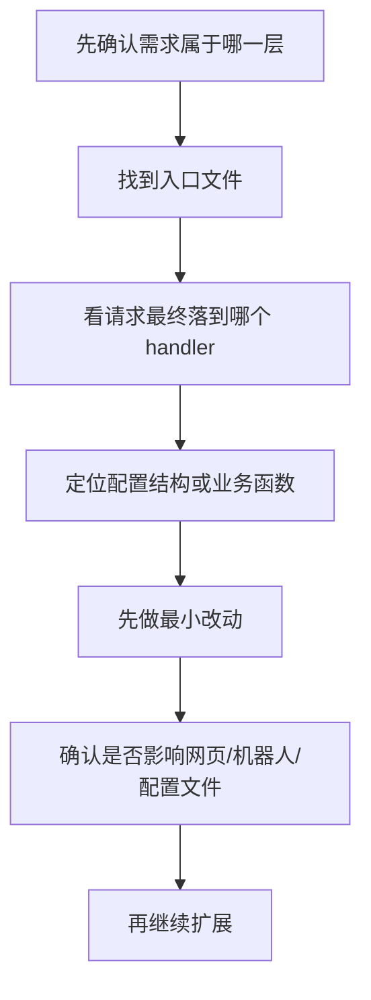

# 二次开发指南

这一份尽量站在“Go 新手”的角度讲，核心目标不是一次性看懂全部代码，而是知道：

- 我想改一个功能，先去哪里
- 我改完之后，可能会影响什么
- 哪些地方先别乱动

## 1. 推荐的二开路径

按难度从低到高，建议这样开始：

1. 改配置页和接口
2. 改自定义意图
3. 改内置意图匹配逻辑
4. 改知识问答/LLM
5. 新增 STT
6. 改 `vector-cloud`

## 2. 常见需求，对应改哪里

| 需求 | 优先改动位置 |
| --- | --- |
| 增加一个网页设置项 | `chipper/webroot/` + `pkg/wirepod/config-ws/webserver.go` |
| 增加一个机器人控制按钮 | `chipper/webroot/sdkapp/` + `pkg/wirepod/sdkapp/` |
| 新增一个“说某句话就触发”的功能 | `customIntents.json` 或 `pkg/wirepod/ttr/matchIntentSend.go` |
| 修改现有意图匹配方式 | `pkg/wirepod/ttr/` |
| 接入新的 LLM 配置 | `pkg/wirepod/ttr/kgsim.go` + `pkg/vars/config.go` |
| 接入新的 STT 引擎 | `pkg/wirepod/stt/` + `cmd/` + `start.sh` |
| 改机器人安装/配网/证书逻辑 | `pkg/wirepod/setup/` |
| 改机器人侧协议兼容 | `vector-cloud/` |

## 3. 最适合新手下手的 4 个方向

### 方向 A：先改网页配置

为什么适合新手：

- 容易看到结果
- 风险相对小
- 不需要先深入 gRPC 和音频流

典型改法：

1. 在 `chipper/webroot/` 加页面字段或按钮
2. 在 `pkg/wirepod/config-ws/webserver.go` 增加 `/api/...` 接口
3. 把配置写入 `vars.APIConfig`
4. 调用 `vars.WriteConfigToDisk()`

### 方向 B：先改自定义意图

适合做：

- 语音触发外部脚本
- 语音执行固定命令
- 语音调用 Lua 脚本

重点看：

- `vars.CustomIntent` 结构
- `pkg/wirepod/config-ws/webserver.go`
- `pkg/wirepod/ttr/matchIntentSend.go` 里的 `customIntentHandler`

### 方向 C：再改内置 intent 匹配

适合做：

- 调整匹配优先级
- 减少误匹配
- 新增内置意图规则

重点看：

- `chipper/intent-data/*.json`
- `pkg/wirepod/ttr/matchIntentSend.go`
- `pkg/wirepod/ttr/intentparam.go`

### 方向 D：最后碰 LLM

适合做：

- 自定义提示词
- 换模型
- 改上下文记忆策略
- 改返回文本清洗逻辑

重点看：

- `pkg/wirepod/ttr/kgsim.go`
- `pkg/vars/config.go`

## 4. 你会最常改到的文件类型

### 1) 入口文件

- `chipper/cmd/*/main.go`

一般不常改，除非你要新增新的 STT 入口。

### 2) 配置结构体

- `chipper/pkg/vars/config.go`
- `chipper/pkg/vars/vars.go`

新增配置项时，通常会先改这里。

### 3) 请求处理函数

- `chipper/pkg/wirepod/preqs/*.go`

适合改“请求怎么分流”。

### 4) 核心业务逻辑

- `chipper/pkg/wirepod/ttr/*.go`

适合改“识别后应该怎么响应”。

### 5) 前端静态页

- `chipper/webroot/`
- `chipper/webroot/sdkapp/`

适合改页面和按钮行为。

## 5. 二开时最值得优先读的顺序

### 第 1 轮，只读这些

1. `pkg/initwirepod/startserver.go`
2. `pkg/wirepod/preqs/server.go`
3. `pkg/wirepod/preqs/intent.go`
4. `pkg/wirepod/ttr/matchIntentSend.go`
5. `pkg/vars/config.go`

### 第 2 轮，按需求读

- 想改网页：读 `config-ws/`
- 想控机器人：读 `sdkapp/`
- 想做问答：读 `kgsim.go`
- 想做安装接入：读 `setup/`

## 6. 新手最容易踩的坑

### 1) 以为只有一个服务

实际上同时存在：

- gRPC/TLS 服务
- 配置页 Web 服务
- SDK 控制页服务

所以你看到 `http.HandleFunc(...)` 很多时，不要惊讶。

### 2) 以为所有逻辑都在 `vector-cloud`

不是。日常二开，大多数逻辑其实在 `chipper/`。

### 3) 以为改 `intent-data` 就够了

有些意图只是“匹配到了名字”，但后面还要走参数处理、天气处理、知识问答、回包逻辑。

也就是说：

- `intent-data/*.json` 负责“听懂什么词”
- `ttr/` 负责“听懂以后怎么办”

### 4) 直接跑 `update.sh`

这个脚本里有 `git reset --hard origin/main`，会强制覆盖本地改动。

二开期间不要随便跑它。

### 5) 一开始就改 `vector-cloud`

这一块涉及机器人侧协议、IPC、token、流式语音，门槛明显更高。

## 7. 推荐你的第一批二开任务

如果你刚上手，我建议先做这 3 类小任务：

1. 新增一个配置项并保存到 `apiConfig.json`
2. 新增一个自定义意图，让机器人说某句话时执行命令
3. 给 SDK 页面加一个按钮，调用已有机器人接口

这三类任务能让你快速熟悉：

- 前端静态页
- Go 后端接口
- 配置落盘
- 机器人控制调用

## 8. 以后你定位问题时的思考模板

看到一个需求，先问自己 4 个问题：

1. 这是网页配置问题，还是语音请求问题？
2. 这是“匹配不到”，还是“匹配到了但响应不对”？
3. 这是主机侧 `chipper` 的事，还是机器人侧 `vector-cloud` 的事？
4. 这是改配置就能解决，还是必须改底层代码？

## 9. 如果你准备正式开始改代码

建议采用这个顺序：

## 10. 一句话总结

对这个项目做二开时，最重要的不是先学会所有 Go 语法，而是先建立下面这个稳定地图：

- 启动在 `initwirepod`
- 请求先到 `preqs`
- 业务主要在 `ttr`
- 配置在 `vars` 和 `config-ws`
- 页面在 `webroot`
- 机器人兼容层在 `vector-cloud`

只要这张地图在脑子里稳定了，后面看代码会轻松很多。

## 11. 关于这次“小智，小智”改造要特别注意什么

这次需求最容易踩坑的地方是：**页面默认文案切到“小智，小智”**，不等于**机器人固件一定已经把真实热词改成“小智，小智”**。

这次改造建议按下面顺序理解：

1. `chipper/webroot/setup.html` 和 `chipper/webroot/sdkapp/` 负责页面与默认入口体验
2. `pkg/wirepod/config-ws/webserver.go` 负责 STT 语言写入与落盘
3. `pkg/wirepod/sdkapp/` 负责机器人 `locale`、`button_wakeword` 和 `vic.RobotSettings` 缓存链路
4. `vector-cloud/internal/voice/process.go` 负责接到 hotword 事件后决定后续 `LanguageCode`

这意味着：

- 大多数“默认体验切到中文”的工作应该优先落在 `chipper/`
- 如果你看到机器人真实说“小智，小智”仍然不能唤醒，不要第一时间怀疑前端页面
- 还要检查：
  - `zh-CN` 的 STT 是否已启用
  - `locale` 是否真的同步到了机器人设置
  - `vector-cloud` 是否仍然回退到了英文语言码
  - 机器人固件 / 上游热词检测是否支持这个新短语

一句话说：这次默认入口迁移主要是 `chipper` 工作，真实语音热词能不能一起改掉，仍然要看更底层的能力边界。
