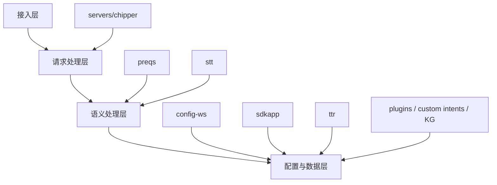
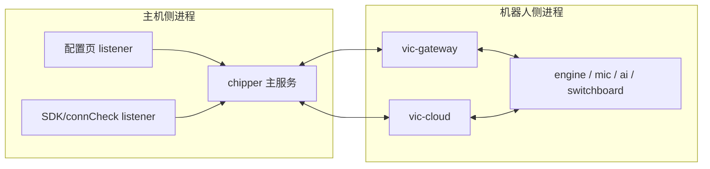
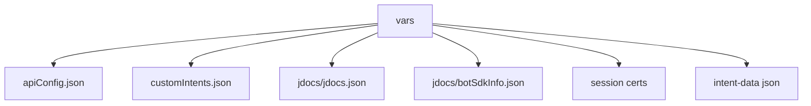
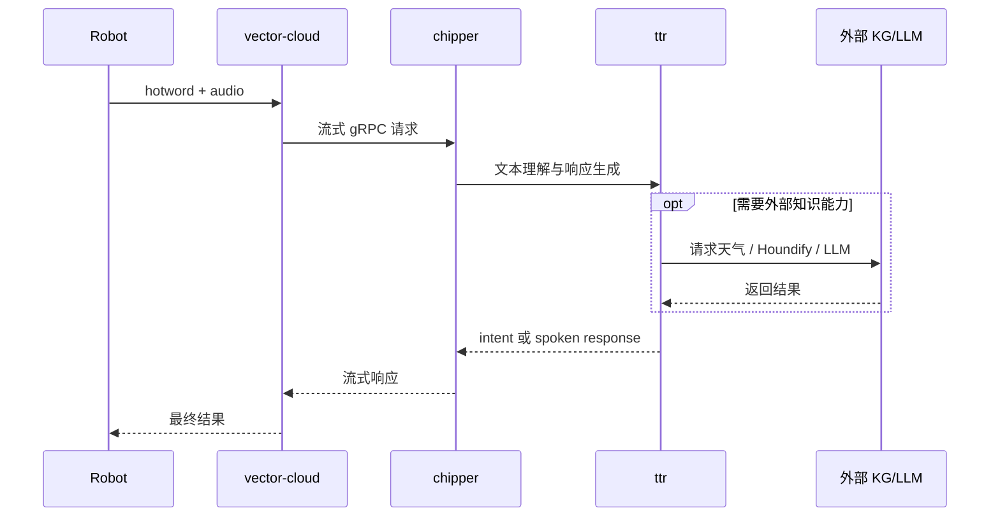
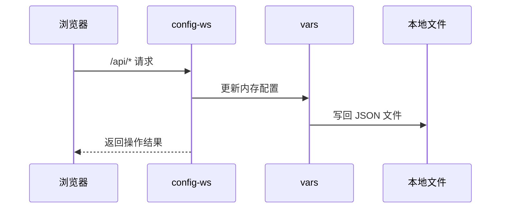

# 软件设计说明

这份文档不是简单的目录介绍，而是按软件设计文档的方式，把 `wire-pod` 的设计目标、约束、视图和扩展点统一整理出来。

## 1. 文档目标

本说明主要服务于后续二次开发，重点回答：

1. 系统的核心职责是什么
2. 为什么它会拆成 `chipper` 和 `vector-cloud`
3. 系统运行时有哪些关键视图
4. 哪些模块适合扩展，哪些模块改动成本高

## 2. 设计目标

从源码实现来看，`wire-pod` 追求的核心目标大致有 5 个：

1. 让 Vector 在脱离官方云后仍然能继续工作
2. 尽量复用机器人原有通信模式，而不是重做一套全新机器人协议
3. 让语音处理能力可替换，可切换不同 STT/KG/LLM 方案
4. 提供本地网页配置和机器人控制能力，降低使用门槛
5. 为二开保留多个扩展入口，而不是把所有功能写死在单一分支逻辑里

## 3. 设计约束

结合代码可以看出，这个项目天然受下面这些约束影响：

### 3.1 兼容机器人已有协议

`vector-cloud` 必须兼容机器人已有的网关、音频、jdocs、token、IPC 行为，所以很多设计不是“最简设计”，而是“兼容优先设计”。

### 3.2 主机侧与机器人侧是分域协作

主机侧 `chipper` 负责业务处理，机器人侧 `vector-cloud` 负责协议适配。这种分层会让链路更长，但也让职责更清晰。

### 3.3 配置和状态大量依赖本地文件

当前实现大量使用 JSON 文件和本地目录保存状态，而不是数据库。这降低了部署复杂度，但也意味着：

- 并发写入要格外小心
- 配置结构变更需要兼容已有文件
- 文件路径和打包路径差异要持续关注

## 4. 逻辑视图

### 分层说明

- 接入层
  - 负责接住外部请求
  - 包括 gRPC 接口、网页接口、SDK 接口
- 请求处理层
  - 负责把不同请求统一成内部处理模型
- 语义处理层
  - 负责 STT、意图匹配、参数提取、知识问答
- 配置与数据层
  - 负责配置读取、jdocs、自定义意图、机器人信息和证书

## 5. 进程视图

### 为什么要这样拆

- `chipper` 更适合承载主机侧业务和页面能力
- `vector-cloud` 更适合承载机器人兼容层和语音流桥接
- 页面和业务处理放在同一进程内，降低了部署复杂度

## 6. 数据视图

### 数据分类

#### 配置类

- `apiConfig.json`
- `server_config.json`

#### 业务规则类

- `intent-data/*.json`
- `customIntents.json`

#### 运行状态类

- `jdocs/jdocs.json`
- `botSdkInfo.json`
- `session-certs/*`

## 7. 关键交互视图

### 7.1 语音主交互

> 针对这次“小智，小智”改造，需要特别注意：默认入口迁移和页面/配置同步主要发生在 `chipper/`；`vector-cloud/` 主要承担 hotword 事件与 locale 透传。当前依赖里的 `LanguageCode` 没有中文值，所以 `zh-CN` 还不能在这里直接变成真正的中文语言码。

### 7.2 页面配置交互

## 8. 可扩展点

这个项目最大的优点之一，是它不是只有一种扩展方式。

### 8.1 低成本扩展点

- 新增/修改配置页接口：`config-ws`
- 新增 SDK 控制按钮：`sdkapp`
- 调整意图词库：`intent-data/*.json`
- 新增自定义意图：`customIntents.json`
- 修改默认唤醒体验文案与 locale 入口：优先改 `chipper/webroot/`、`chipper/webroot/sdkapp/`、`pkg/wirepod/sdkapp/`

### 8.2 中成本扩展点

- 修改意图优先级和参数提取：`ttr/`
- 接入新的知识服务：`kgsim.go`、`preqs/knowledgegraph.go`
- 新增 STT 实现：`stt/` + `cmd/`

### 8.3 高成本扩展点

- 修改机器人云兼容流程：`vector-cloud/`
- 修改 token/jdocs/gateway/IPC 行为
- 重构音频流转链路

## 9. 设计上的优势与代价

### 优势

- 模块边界相对明确
- 业务大脑集中，便于定位
- 扩展入口多
- 不依赖复杂数据库或微服务编排

### 代价

- 运行时链路较长，跨进程排查成本高
- 历史兼容逻辑较多，理解门槛不低
- 默认 `http` mux + 多监听端口的方式灵活，但容易让新手误判路由归属
- 很多状态落本地文件，后续做更复杂特性时需要更谨慎地处理一致性

## 10. 二开建议

如果你的目标是后续稳定地做功能开发，建议按下面顺序建立自己的认知：

1. 先读懂 `chipper` 的启动和语音主链路
2. 再理解 `config-ws`、`sdkapp`、`vars`
3. 最后再碰 `vector-cloud`

如果你的需求属于以下几类，优先落在这些地方：

| 需求类型 | 优先落点 |
| --- | --- |
| 新配置项 | `config-ws` + `vars` |
| 新语音行为 | `customIntents.json` 或 `ttr/` |
| 新问答能力 | `kgsim.go` / `preqs/knowledgegraph.go` |
| 新 STT | `stt/` + `cmd/` |
| 机器人侧协议改造 | `vector-cloud/` |

## 11. 一句话结论

`wire-pod` 的本质可以概括成一句话：

> `vector-cloud` 负责把机器人原生云协议桥接出来，`chipper` 负责把这些请求真正处理成可执行的业务响应。

只要先把这句话建立稳，后面再看具体文件时就不会迷路。
