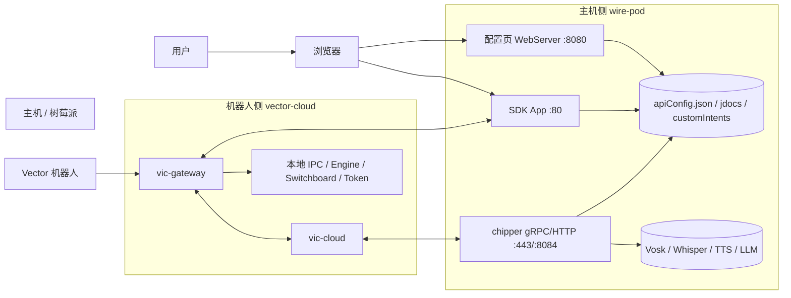
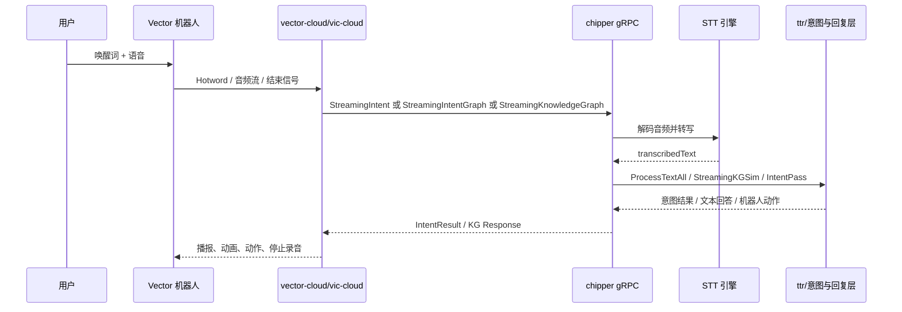
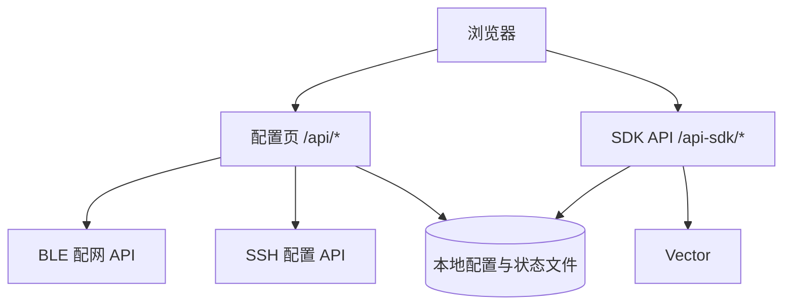

# wire-pod 系统架构

## 1. 项目定位

`wire-pod` 是一个围绕 Vector 机器人构建的本地化语音服务系统。当前仓库实际上由两块核心能力组成：

- `chipper/`：主机侧服务，负责语音识别、意图识别、知识问答、Web 配置和 SDK 控制
- `vector-cloud/`：机器人侧兼容层，负责把机器人本地音频、认证、jdocs、gateway 等能力接到 `chipper`

简单理解：

- `vector-cloud` 更靠近机器人固件和本地 IPC
- `chipper` 更靠近语音理解、配置管理和用户界面

## 2. 运行时角色

### 主机侧

- `chipper` gRPC 服务
  - 入口初始化：`chipper/pkg/initwirepod/startserver.go`
  - 主要处理：
    - `StreamingIntent`
    - `StreamingIntentGraph`
    - `StreamingKnowledgeGraph`
- 配置 Web 服务
  - 入口：`chipper/pkg/wirepod/config-ws/webserver.go`
  - 默认端口：`8080`
- SDK App / 控制服务
  - 入口：`chipper/pkg/wirepod/sdkapp/server.go`
  - 默认端口：`80`

### 机器人侧

- `vic-cloud`
  - 入口：`vector-cloud/cloud/main.go`
  - 负责音频流、token、jdocs、offboard vision、cloud process 协调
- `vic-gateway`
  - 入口：`vector-cloud/gateway/main.go`
  - 提供机器人外部接口 gRPC/JSON 网关，并桥接本地 IPC

## 3. 部署视图

## 4. 语音请求主链路

这是当前项目最核心的闭环。

### 关键代码对应

- 机器人侧语音处理主循环：
  - `vector-cloud/internal/voice/process.go`
- 机器人到主机的流式连接：
  - `vector-cloud/internal/voice/stream/*`
- 主机侧 gRPC 注册：
  - `chipper/pkg/initwirepod/startserver.go`
- gRPC 语音入口：
  - `chipper/pkg/servers/chipper/intent.go`
  - `chipper/pkg/servers/chipper/intent_graph.go`
  - `chipper/pkg/servers/chipper/knowledgegraph.go`
- 主机侧请求处理：
  - `chipper/pkg/wirepod/preqs/*`
- 文本到响应：
  - `chipper/pkg/wirepod/ttr/*`

## 5. 管理与配置链路

### 配置链路说明

- 配置页负责：
  - 首次安装与接入
  - STT / KG / 天气 / 证书等设置
  - 自定义意图管理
- SDK App 负责：
  - 查看机器人状态
  - 修改 `locale`、音量、时区、位置等设置
  - 行为控制、相机流、面孔管理、播放音频

## 6. 关键端口与接口

| 能力 | 默认端口 | 说明 |
|---|---:|---|
| `chipper` 主服务 | `443` | 主语音 gRPC/TLS 服务 |
| `chipper` 兼容端口 | `8084` | Escape Pod 兼容端口 |
| SDK App | `80` | 机器人连接检查与 Web 控制 |
| 配置页 | `8080` | 管理后台和 setup 页面 |
| `vector-cloud` dev server | `8890` | 机器人侧开发服务器，仅 dev 场景 |

## 7. 核心设计特点

### 7.1 双端协作架构

这个仓库不是单体 Web 应用，而是“机器人端兼容层 + 主机端业务服务”组合体。

### 7.2 流式语音优先

语音链路以流式音频为核心，先由机器人侧收集热词和音频，再把流发往主机侧处理。

### 7.3 多引擎可插拔

`chipper` 支持多种 STT 和知识能力来源，比如：

- `vosk`
- `whisper`
- `whisper.cpp`
- `coqui`
- `houndify`
- 自定义 LLM / TTS endpoint

### 7.4 Web 配置与运行时业务共存

当前代码中，配置页、SDK App、chipper HTTP API 共用同一个 Go 进程中的多个 `http.Handle*` 注册点，因此：

- 启动逻辑集中
- 依赖全局状态较多
- 新功能接入速度快
- 模块边界相对偏“工程化聚合”而不是严格分层

## 8. 当前架构的边界与注意点

### 8.1 主流程代码与实验代码并存

仓库里除了主线代码，还混有：

- `bak` / `bakgo` 备份文件
- 根目录下独立的 `kgsim.go`
- 若干实验 `cmd/experimental/*`

这些文件适合参考，但不应默认当作主运行路径。

### 8.2 配置与运行状态强依赖本地文件

例如：

- `chipper/apiConfig.json`
- `chipper/jdocs/*.json`
- `chipper/customIntents.json`
- `certs/*`

这意味着部署、迁移、排障都需要同时关注代码和文件状态。

### 8.3 机器人本地能力并不完全由主机控制

比如唤醒词、固件行为、部分认证/locale 能力，仍受机器人本地固件和 `vector-cloud` 侧逻辑约束。
