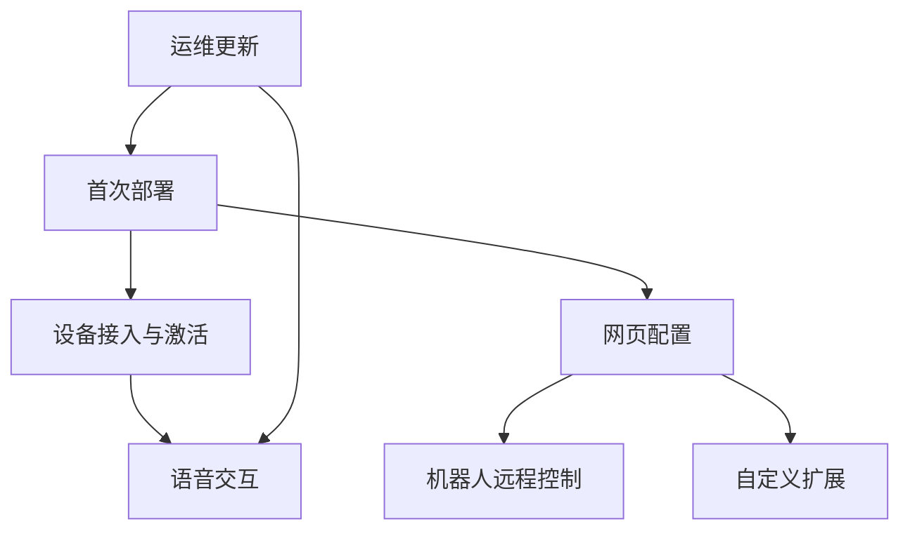
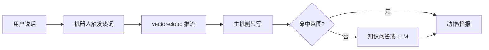

# wire-pod 用户故事

## 1. 主要角色

从当前代码和功能分布看，这个项目主要服务下面几类角色：

- 最终用户：对着 Vector 说话，希望机器人能听懂并回答
- 设备管理员：负责部署 `wire-pod`、完成首配、管理证书和网络
- 机器人拥有者：希望在网页里改设置、控制机器人、调试连接
- 功能扩展者：希望加自定义意图、Lua 脚本、插件、外接 LLM/TTS/STT
- 运维/开发者：希望部署到树莓派、更新代码、排查端口和服务问题

## 2. 用户故事地图

## 3. 核心用户故事

### 故事 1：作为部署者，我想快速把 wire-pod 跑起来

**目标**

- 安装依赖
- 选择 STT
- 生成配置
- 启动服务

**对应代码**

- `setup.sh`
- `dockerfile`
- `compose.yaml`
- `chipper/start.sh`
- `chipper/pkg/initwirepod/startserver.go`

**价值**

- 让用户在本地网络里替代官方云端能力

### 故事 2：作为管理员，我想通过网页完成首次配置和接入

**目标**

- 打开配置页
- 配置 STT / KG / 天气 / 证书
- 通过 BLE / SSH 完成接入
- 让机器人能连到本地服务

**对应代码**

- `chipper/pkg/wirepod/config-ws/webserver.go`
- `chipper/pkg/wirepod/setup/ble.go`
- `chipper/pkg/wirepod/setup/ssh.go`
- `chipper/pkg/wirepod/setup/certs.go`
- `chipper/webroot/*`

**价值**

- 降低首次安装门槛
- 让接入过程不依赖手工改大量文件

### 故事 3：作为最终用户，我想对机器人说话并得到回应

**目标**

- 说出语音命令
- 被转写为文字
- 命中意图或走知识问答
- 播放回复、动作和动画

**对应代码**

- `vector-cloud/internal/voice/process.go`
- `vector-cloud/internal/voice/stream/*`
- `chipper/pkg/servers/chipper/*`
- `chipper/pkg/wirepod/preqs/*`
- `chipper/pkg/wirepod/stt/*`
- `chipper/pkg/wirepod/ttr/*`

**价值**

- 这是项目最核心的用户体验闭环

### 故事 4：作为机器人拥有者，我想在网页中修改机器人设置

**目标**

- 修改音量、时区、位置、温度单位
- 查看机器人设置与电池
- 调整 `locale`

**对应代码**

- `chipper/pkg/wirepod/sdkapp/server.go`
- `chipper/pkg/wirepod/sdkapp/urlreqs.go`
- `chipper/pkg/wirepod/sdkapp/robot.go`
- `chipper/webroot/sdkapp/js/*`

**价值**

- 把原本需要 SDK/脚本的事情做成网页操作

### 故事 5：作为高级用户，我想远程控制机器人

**目标**

- 控制轮子、头、升降机构
- 拉取相机流
- 管理面孔
- 播放音频

**对应代码**

- `chipper/pkg/wirepod/sdkapp/server.go`
- `chipper/webroot/sdkapp/control.html`
- `chipper/webroot/sdkapp/js/control.js`

**价值**

- 让机器人不仅能“说话”，还能被“操作”

### 故事 6：作为扩展者，我想加入自己的意图和自动化逻辑

**目标**

- 新增自定义意图
- 绑定执行命令
- 绑定 Lua 脚本
- 加插件
- 对接自定义 LLM/TTS 接口

**对应代码**

- `chipper/pkg/wirepod/config-ws/webserver.go`
- `chipper/pkg/scripting/scripting.go`
- `chipper/plugins/*`
- `chipper/pkg/wirepod/ttr/plugins.go`
- `chipper/pkg/vars/config.go`

**价值**

- 让项目成为平台，而不仅仅是一个固定功能的软件

### 故事 7：作为运维者，我想安全地更新和重启服务

**目标**

- 同步代码到树莓派
- 重启 `wire-pod.service`
- 观察日志
- 避免把本地状态文件误覆盖

**对应代码**

- `scripts/deploy_to_escapepod.sh`
- `update.sh`
- `chipper/start.sh`

**价值**

- 提高真实硬件环境下的迭代效率

## 4. 故事与模块映射

| 用户故事 | 主要模块 |
|---|---|
| 首次部署 | `setup.sh`、`dockerfile`、`compose.yaml`、`start.sh` |
| 首配接入 | `config-ws`、`setup`、`webroot` |
| 语音交互 | `vector-cloud/internal/voice`、`servers/chipper`、`preqs`、`stt`、`ttr` |
| 网页设置 | `sdkapp`、`webroot/sdkapp` |
| 远程控制 | `sdkapp/server.go`、`sdkapp/robot.go`、`control.js` |
| 自定义扩展 | `config-ws`、`scripting`、`plugins`、`ttr` |
| 部署运维 | `scripts/`、`update.sh`、systemd / start.sh |

## 5. 两条最重要的用户旅程

### 旅程 A：首次上线

### 旅程 B：一次语音问答

## 6. 从产品角度看，这个项目真正解决了什么问题

当前代码体现出的产品核心，不只是“让机器人离线可用”，而是三件事一起成立：

1. 让机器人摆脱官方云服务依赖
2. 让普通用户也能通过网页完成接入与管理
3. 让高级用户继续扩展语音、动作和自动化能力

## 7. 后续继续补文档时，建议优先完善的方向

- 补一份“启动时序图”
- 补一份“端口 / 协议 / 证书关系说明”
- 补一份“自定义意图和 Lua 扩展开发指南”
- 补一份“树莓派部署与 systemd 运维手册”
